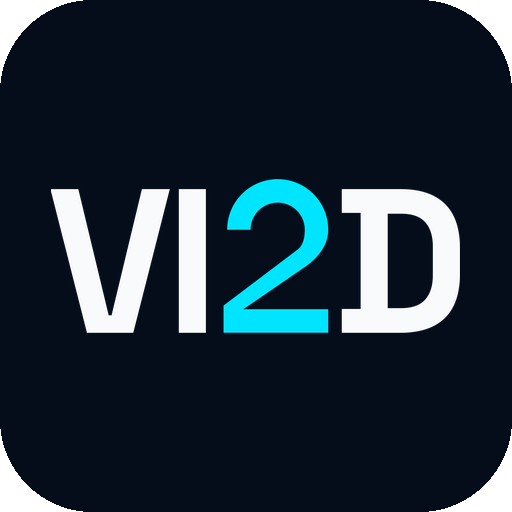

  

<h1 align="center">VI2D PRO</h1>

  <b>Free, open-source system cleaner & security scanner for Windows, macOS, and Linux.</b> 
  Reclaim disk space. Remove malware. Take back your privacy. All in one app.

  
  
  
  
  
  

  <a href="https://github.com/DvaKarma/vi2d-pro/releases"><b>Download</b></a> &nbsp;&middot;&nbsp;
  <a href="https://usekudu.com"><b>Website</b></a> &nbsp;&middot;&nbsp;
  <a href="https://usekudu.com/cleaners"><b>Cleaners</b></a> &nbsp;&middot;&nbsp;
  <a href="CLI.md"><b>CLI Docs</b></a>

---

## Download

Get the latest installer for your platform from [GitHub Releases](https://github.com/DvaKarma/vi2d-pro/releases):

| Platform | Format |
|----------|--------|
| Windows | `.exe` installer |
| macOS | `.dmg` (Intel & Apple Silicon) |
| Linux | `.AppImage` or `.deb` |

## Why VI2D PRO?

Most system cleaners are closed-source, ad-filled, and want your money. Some are barely disguised malware themselves.

VI2D PRO is **100% free, open-source, and transparent**. No ads, no upsells, no telemetry. You can read every line of code, audit every scan, and verify every delete. Built by developers who were tired of recommending CCleaner with a straight face.

## What It Does

<table>
<tr>
<td width="33%" valign="top">

### Cleaning & Optimization
- **System Cleaner** — temp files, logs, caches, crash dumps
- **Browser Cleaner** — caches across all major browsers
- **App Cleaner** — leftover app data
- **Gaming Cleaner** — game launcher & shader caches
- **Registry Cleaner** — broken/orphaned entries
- **Startup Manager** — boot impact analysis
- **Network Cleanup** — DNS, Wi-Fi profiles, ARP cache
- **Disk Analyzer** — interactive treemap of disk usage
- **Debloater** — remove Windows bloatware
- **Driver Manager** — stale driver cleanup
- **Program Uninstaller** — uninstall + leftover cleanup
- **Service Manager** — optimize Windows services
- **Software Updater** — bulk-update across winget, Chocolatey, Scoop & npm

</td>
<td width="33%" valign="top">

### Security & Privacy
- **Malware Scanner** — signature matching, heuristic analysis, Defender integration
- **Privacy Shield** — control 30+ Windows privacy settings (telemetry, ad ID, Cortana, tracking)
- **Secure Delete** — overwrite files with random data before deletion

</td>
<td width="33%" valign="top">

### Monitoring & Tools
- **Performance Monitor** — real-time CPU, memory, disk, network, per-core stats, S.M.A.R.T.
- **System Restore Points** — create restore points before cleaning
- **Cleaning History** — track past sessions & space recovered
- **Scheduled Scans** — daily, weekly, or monthly
- **One-Click Clean** — scan & clean everything in one click
- **[CLI Mode](CLI.md)** — scriptable, no GUI required

</td>
</tr>
</table>

## Languages

VI2D PRO is available in 30 languages:

English, Spanish, French, German, Portuguese, Italian, Japanese, Korean, Chinese (Simplified), Chinese (Traditional), Russian, Arabic, Hindi, Turkish, Dutch, Polish, Swedish, Norwegian, Danish, Finnish, Czech, Thai, Vietnamese, Indonesian, Malay, Ukrainian, Romanian, Greek, Hebrew, Hungarian

## Disclaimer

VI2D PRO by design removes files from your system. You are responsible for reviewing items before removal. We accept no liability for data loss or system instability. This software is provided "as is" without warranty.

## Contributing

Contributions are welcome! Feel free to open issues, submit PRs, or suggest features.

**Want to add a cleaner for your favorite app?** VI2D PRO's cleaning rules are simple JSON files — no code required. See the [Cleaner Rules Guide](rules/RULES.md) to get started, or browse the [full cleaner directory](https://usekudu.com/cleaners) to see what's already covered.

If you find VI2D PRO useful, consider giving it a star — it helps others discover the project.

## License

[MIT](LICENSE)
